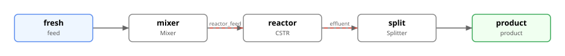
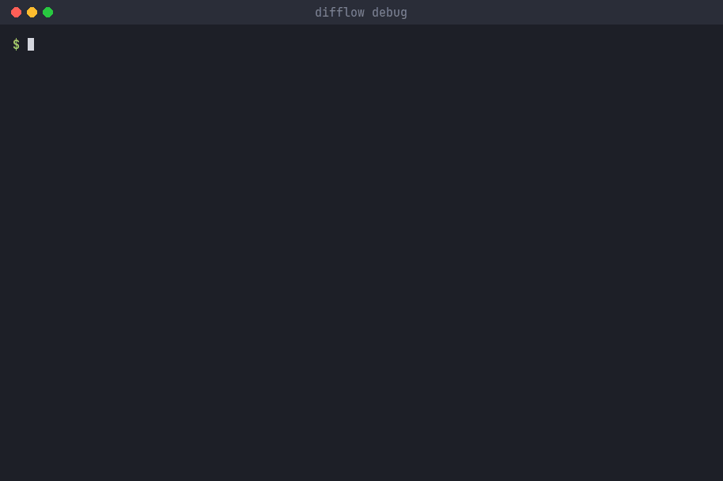
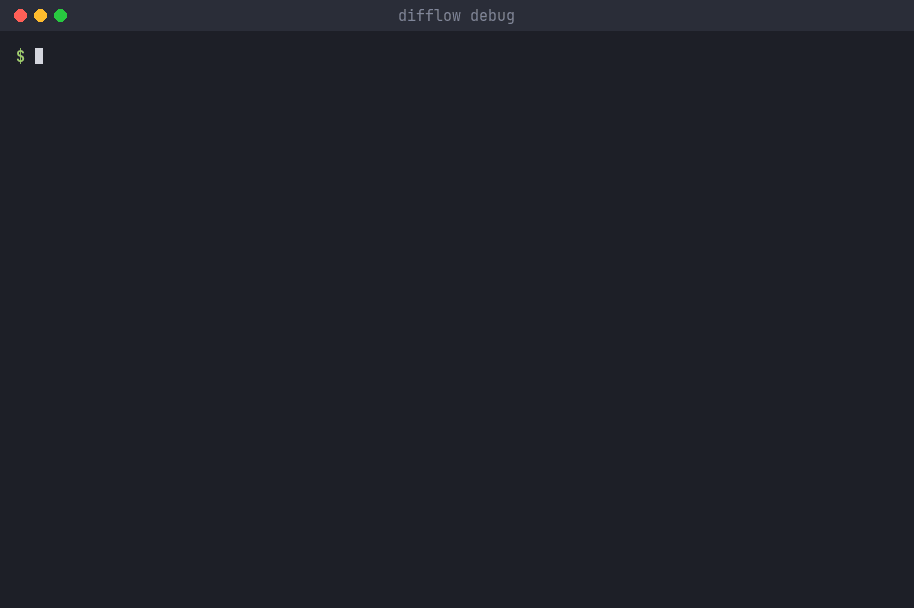
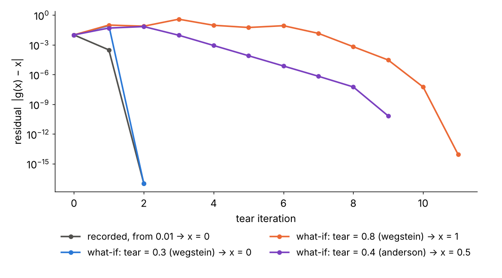
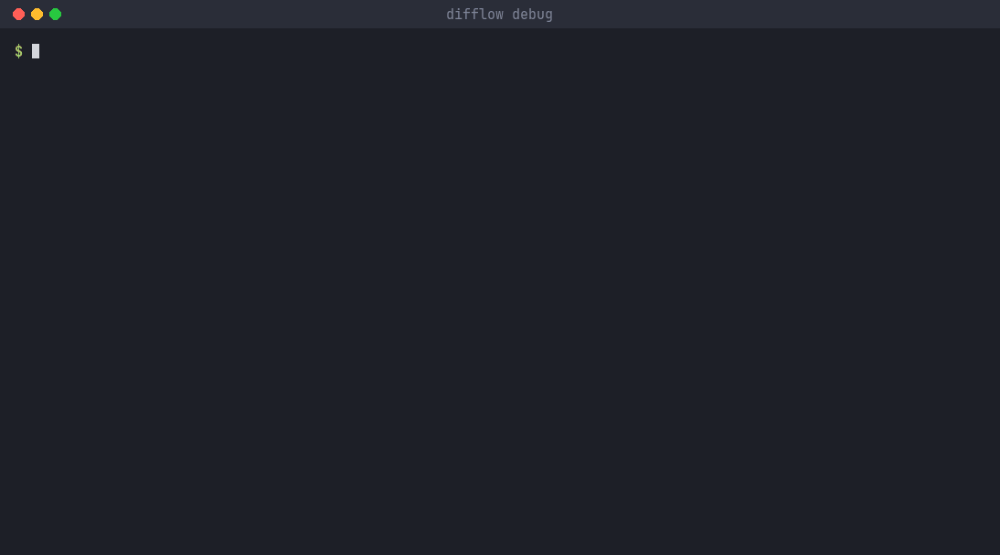

<!-- _class: lead -->
<!-- _paginate: false -->
<!-- _footer: "" -->

# Watching a flowsheet solve fail

The difflow flowsheet debugger, step by step

`difflow debug plant.py`

---

## Why a debugger

# A failed solve tells you *that*, not *where*

- A recycle that will not close usually fails somewhere specific: a unit returns a NaN on the first pass, one tear field oscillates, a reactor's own solve gives up.
- `fs.solve()` warns, and `difflow.diagnostics` reads the residual history. Both describe the **end** of the solve.
- The debugger lets you **watch** the solve: it pauses unit by unit and tear iteration by tear iteration, shows every stream, and stops on breakpoints.

<p class="note">It is not <code>pdb</code>: <code>pdb</code> stops on lines of Python. This stops on the flowsheet's own structure, such as <em>before unit R1</em>, <em>at iteration 12</em>, <em>when the residual rises</em> or <em>where the first NaN is born</em>, and its commands speak streams, units and tears.</p>

---

## The example

# An isomerization loop with a recycle



<div class="cols">

```python
# plant.py
fs = Flowsheet(species_order=species)
fs.add_feed("fresh", make_stream({...}, T=340.0, P=101325.0))
fs.add_unit(Unit("mixer", Mixer(species, thermo),
                 ["fresh", "recycle"], ["reactor_feed"]))
fs.add_unit(Unit("reactor", reactor, ["reactor_feed"],
                 ["effluent"], params={"T_spec": 340.0}))
fs.add_unit(Unit("split", Splitter(species), ["effluent"],
                 ["recycle", "product"], params={"split_frac": 0.8}))
fs.add_recycle("recycle", "recycle")    # the tear stream
```

<div class="small">

n-hexane → 2-methylpentane in a CSTR; 80 % of the effluent goes back to the mixer.

`recycle` is the **tear**: the solver guesses it, runs the units, compares what comes back, and repeats until the two agree.

All the recordings that follow are real runs of this file.

</div>
</div>

---

## Step 1 · start it

# `difflow debug plant.py`

<div class="cols-wide">
<div class="term">



</div>
<div class="small">

It stops **before the first pass** (`solve_start`).

- `where`: the calculation order; `*` marks the tear
- `next`: run to the next unit
- `p STREAM`: a stream as it is right now
- `p UNIT`: its parameters, and what it reported (`info`)
- `continue`: run to the end (it stops once at `terminated` to show the verdict)

The first units run in the **init** phase: one pass from the feeds to guess the tear.

</div>
</div>

---

## Where it stops

# Checkpoints and phases

| Checkpoint | Fires | Fresh at that point |
|---|---|---|
| `solve_start` | once, before anything runs | the feeds |
| `before_unit` / `after_unit` | around every unit call | the inlets; then the outlets and the unit's `info` |
| `unit_error` | a unit raised | the inlets that broke it |
| `iteration` | the tear map was evaluated | `x`, `g(x)`, the residual, the history |
| `after_accel` | Wegstein/Anderson made the next guess | the guess (`p next`) |
| `terminated` | the solve is about to return | the verdict |

<p class="note">Unit pauses carry a <b>phase</b>: <code>init</code> (the tear-guessing pass) · <code>solve</code> · <code>probe</code> (error probe after convergence) · <code>final</code>. &nbsp;<code>step</code> runs to the next iteration, <code>next</code> to the next unit, <code>stepi</code> to the next checkpoint of any kind.</p>

---

## Step 2 · follow the tear

# `step`, `p tear`, `p history`

<div class="cols-wide">
<div class="term">


</div>
<div class="small">

`step` runs a whole pass and stops at the next **tear iteration**.

`p tear` breaks the residual down by stream and field, largest first:
`x` is the guess the pass ran on, `g(x)` is what the loop sent back.

`p history` reads the residual so far:

> falling, about ×0.039 per iteration

(mid-solve it reports the observed rate; at the end, the verdict on the solve).

</div>
</div>

---

## Step 3 · breakpoints

# Stop where it matters

<div class="cols-wide">
<div class="term">


</div>
<div class="small tight">

| | |
|---|---|
| `break split` | before unit `split`, every pass |
| `break 4`, `tbreak 4` | at iteration 4 (once) |
| `break if residual<1e-6 && iter>1` | a condition |
| `break on nonfinite` | where a NaN is born |
| `break on residual_rise` | the residual went up |
| `watch recycle.F_n_hexane` | print it at every stop |

`break` lists them; `break clear` removes them.

</div>
</div>

---

## Step 4 · post mortem

# Where is the NaN born?

<div class="cols">
<div>

A preheater with a bug: fine above 400 K, NaN below.

```python
def preheat(stream):
    T_out = stream["T"] + 10.0 * jnp.log(stream["T"] - 400.0)
    ...
```

The plain solve says only `residual: nan`: by then every stream is NaN.

`--on-error` runs freely and stops **once**, at the first unit that turns *finite* inlets into a NaN (or raises, or the solve ends unconverged).

Here: `preheat`, in the **init** pass, before anything reached the tear.

</div>
<div class="term">



</div>
</div>

---

## Step 5 · try a different guess

# `set tear STREAM.FIELD VALUE`

<div class="cols-wide">
<div class="term">


</div>
<div class="small">

The one thing the debugger changes: the guess the **next pass** runs on.

- at an `iteration` pause it replaces that step
- at `after_accel` it edits the accelerated guess

An edit changes the **route**, not the fixed point: here 16 iterations instead of 6, the same product.

The edit is recorded in `fs.last_solve_debug_edits`, so an edited solve is never mistaken for a plain one.

</div>
</div>

---

## From Python

# The same debugger in a script or notebook

<div class="cols">
<div>

```python
from difflow import debug

with debug.attach():                 # a prompt here
    fs.solve(acceleration="wegstein")

with debug.attach(on_error=True):    # post mortem only
    fs.solve()
```

```python
from difflow.debug.runner import DebugRunner

runner = DebugRunner(fs, {"acceleration": "wegstein"})
runner.start()                          # pause event
runner.command("break on nonfinite")    # result event
runner.command("continue")["next"]      # the next pause
runner.close()
```

</div>
<div class="small">

`debug.attach()` gives the same `difflow-dbg>` prompt from a script or a notebook.

`DebugRunner` runs the solve on a worker thread and hands back **one event per call**: the shape a server, an editor or an agent needs.

Detached, a solve is exactly what it was: one thread-local read per checkpoint. Attached, it only reads (apart from `set tear`), and `quit` raises `DebugQuit` rather than returning a partial answer.

</div>
</div>

---

## Step 6 · record a solve

# `debug.record`: every checkpoint, kept

<div class="cols">
<div>

```python
from difflow.debug.record import summarize, state_at

trace = debug.record(fs, {"acceleration": "wegstein"})
s = summarize(trace)
```

```text
80 frames, 6 iterations, reads as: converged
frame  13  iter 0  4.25e-01  recycle.F_n_hexane
frame  20  iter 1  3.40e-01  recycle.F_n_hexane
frame  28  iter 2  6.52e-04  recycle.F_2_methylpentane
frame  36  iter 3  2.37e-04  recycle.F_n_hexane
frame  44  iter 4  2.24e-07  recycle.F_n_hexane
frame  52  iter 5  5.97e-08  recycle.F_n_hexane
frame  60  iter 6  2.87e-11  recycle.F_2_methylpentane
```

</div>
<div class="small">

A recording solves once with nobody at the prompt.

Each frame holds only what that step wrote (the feeds, a unit's outlets, the tear iterate), so `state_at(trace, i)` is every stream at frame `i`.

`summarize` is the trace without its frames: one row per tear iteration, with the field the residual is mostly made of.

</div>
</div>

---

## Step 7 · what if?

# Replay the solve with one value changed

<div class="cols-wide">
<div>



</div>
<div class="small">

```python
replay = debug.record(fs, kw, baseline=trace["frames"],
    edits=[{"frame": k, "stream": "tear",
            "field": "F_A", "value": 0.8}])
compare(trace, replay)["same_answer"]   # False
```

A **replay**, not a fresh solve: everything before frame `k` is the recording (`diverged_at` checks it), and the accelerator keeps its history.

On a loop with steady states at 0 and 1:
0.3 comes back to 0; 0.8 reaches **1**.
Anderson from 0.4 converges to **0.5**, the *unstable* middle state.

</div>
</div>

---

## Step 8 · drive it from a program

# `difflow debug --json`



<p class="note">The <code>difflow-dbg/1</code> protocol, one JSON object per line: a <code>hello</code> listing every checkpoint, event, command and capability, then a <code>pause</code> at each stop and a <code>result</code> per command. (Null fields left out here.)</p>

---

## For agents

# The same debugger as MCP tools

<div class="cols">
<div class="small">

`difflow mcp` serves:

| Tool | |
|---|---|
| `debug_guide` | the contract + the handshake |
| `debug_start` | pause before the first pass, or `on_error` |
| `debug_command` | any command; a resume returns the next stop |
| `debug_wait` / `debug_pause` | follow / stop a running solve |
| `debug_record` | a solve, summarized per iteration |
| `debug_trace_frame` | one frame in full |
| `debug_whatif` | a replay, compared: `same_answer` |

</div>
<div class="small">

The `fix_convergence` prompt uses them when the findings alone do not say why:

1. `debug_start`
2. `break on nonfinite`, `break on residual_rise`, `continue`
3. at the stop: `print tear`, `print history`, `diagnose`
4. `print` the unit at fault and its inlets
5. report the unit and the stream; `debug_stop`

Each solve runs on a **copy**: debugging never changes the session's flowsheet.

</div>
</div>

---

## In the editor · the book's app

# Debug panel: a live solve, stepped

<video src="assets/panel-debug.mp4" poster="assets/panel-debug.png" autoplay loop muted playsinline></video>

<p class="note">Start · Next unit (the canvas outlines the unit) · a breakpoint on the selected unit · Step iteration (the tear table) · the command line: <code>p reactor_feed</code>, <code>set tear …</code> · Continue to the end.</p>

---

## In the editor · the book's app

# Trace panel: scrub a recording, then ask *what if*

<video src="assets/panel-trace.mp4" poster="assets/panel-trace.png" autoplay loop muted playsinline></video>

<p class="note">Record solve · step by unit, then by tear iteration · <b>What if</b> the next pass ran on 3? · the replay against the faint recording · play.</p>

---

## Cheat sheet

# What to type

<div class="cols small tight">

| To | Type |
|---|---|
| start | `difflow debug plant.py` |
| post mortem | `difflow debug plant.py --on-error` |
| next unit / iteration / checkpoint | `next` · `step` · `stepi` |
| run on / to N / stop | `continue` · `run N` · `quit` |
| where am I | `info` · `where` |
| look | `p STREAM` · `p S.FIELD` · `p UNIT` |
| the tear | `p tear` · `p history` · `diagnose` |

| To | Type |
|---|---|
| break before a unit | `break UNIT` |
| break on a condition | `break if residual>1e3` |
| break on an event | `break on nonfinite` |
| watch a value | `watch S.FIELD` |
| try another guess | `set tear S.FIELD VALUE` |
| keep a solve | `debug.record(fs)` |
| ask what if | `record(edits=, baseline=)` |

</div>

---

## Limits, and where to read more

# What it can and cannot step

- **Steps** the eager tear iteration: `acceleration="anderson"` (the default) and `"wegstein"`. `"none"` iterates inside optimistix: the debugger sees its start and end only.
- **Nothing fires under `jax.grad` or `jit`**: a traced solve is traced once, not run.
- **A unit is one step.** Its own inner solve (a CSTR's Newton iteration) is not stepped; what it reports in `info` is shown, and `break on inner_unconverged` stops on it.
- **It edits tear values only**, never parameters.

<p class="note"><code>docs/debugger.md</code> · <code>examples/69_flowsheet_debugger.ipynb</code> · <code>docs/agents.md</code> · the editor app comes with the difflow book.</p>
